<!-- HERO -->

<!-- PROFILE -->

<!-- ARCHITECTURE -->

<!-- STACK -->

<!-- CONTACT (click to email) -->

<!-- SOUNDTRACK — GitHub strips audio/iframes/JS from READMEs, so the panel links out to Spotify instead -->

<!-- FOOTER -->

